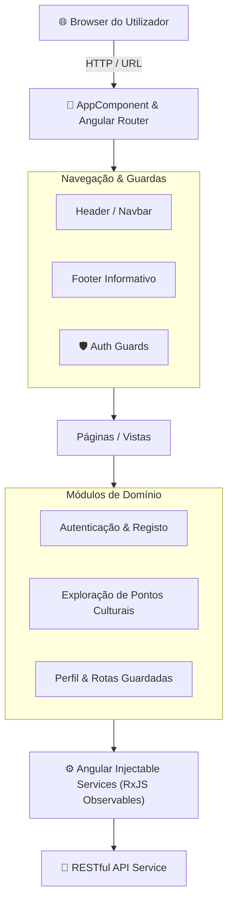

<div align="center">
  <h1>🌍 Cultural Odyssey — Web Platform</h1>
  <p><strong>Plataforma Web Interativa para Exploração e Gestão de Património Cultural</strong></p>

  [](https://angular.dev/)
  [](https://www.typescriptlang.org/)
  [](https://rxjs.dev/)
  [](https://sass-lang.com/)
</div>

---

## 📌 Sobre o Projeto

O **Cultural Odyssey** é uma aplicação web rica desenvolvida em **Angular 18** e **TypeScript**, concebida para proporcionar aos utilizadores uma experiência imersiva de descoberta, catalogação e partilha de pontos de interesse histórico, rotas culturais e tradições.

A plataforma foca-se numa navegação fluida em Single Page Application (SPA), gestão modular de componentes, autenticação segura e layouts adaptáveis a qualquer resolução de ecrã.

---

## 🏗️ Arquitetura do Frontend (Angular SPA)



---

## 🚀 Principais Funcionalidades

- **Exploração Cultural:** Catálogo interativo de monumentos, museus, sítios arqueológicos e património imaterial.
- **Autenticação & Perfil de Utilizador:** Registo de viajantes, login, favoritos e histórico de experiências.
- **Interface Responsiva:** Design flexível com barra de navegação adaptativa (`navbar`), rodapé informativo (`cFooter`) e ecrãs otimizados para smartphones, tablets e desktop.
- **Arquitetura Modular em Angular 18:** Implementação seguindo as melhores práticas do ecossistema Angular (StandAlone Components / Módulos, Injeção de Dependências, RxJS e Pipes).

---

## 📂 Estrutura do Projeto

```text
src/
├── app/
│   ├── components/      # Componentes estruturais (Navbar, Footer, Cards Culturais)
│   ├── pages/           # Vistas da aplicação (Auth, Exploração, Detalhe)
│   ├── services/        # Serviços de comunicação HTTP e gestão de estado
│   ├── guards/          # Guardas de rota para controlo de acesso
│   ├── app.routes.ts    # Definição e mapeamento das rotas
│   └── app.component.ts # Componente raiz da aplicação
├── assets/              # Imagens, ícones e recursos estáticos
└── styles.scss          # Folhas de estilo globais (SCSS)
```

---

## 💻 Instalação & Execução Local

### Pré-requisitos
* [Node.js](https://nodejs.org/) (versão 18.x ou 20.x recomendada)
* [Angular CLI](https://angular.dev/tools/cli) (`npm install -g @angular/cli`)

### 1. Clonar o Repositório
```bash
git clone https://github.com/Dev2C1Vieira/Web_CulturalOdyssey.git
cd Web_CulturalOdyssey
```

### 2. Instalar as Dependências
```bash
npm install
```

### 3. Iniciar o Servidor de Desenvolvimento
```bash
ng serve
```
Navega até `http://localhost:4200/` no teu navegador para aceder à aplicação. A página será atualizada automaticamente a cada alteração no código.

### 4. Compilar para Produção
```bash
ng build --configuration production
```
Os artefactos de distribuição serão gerados na diretoria `dist/`.

---

<div align="center">
  <sub>Desenvolvido no âmbito do projeto Cultural Odyssey.</sub>
</div>